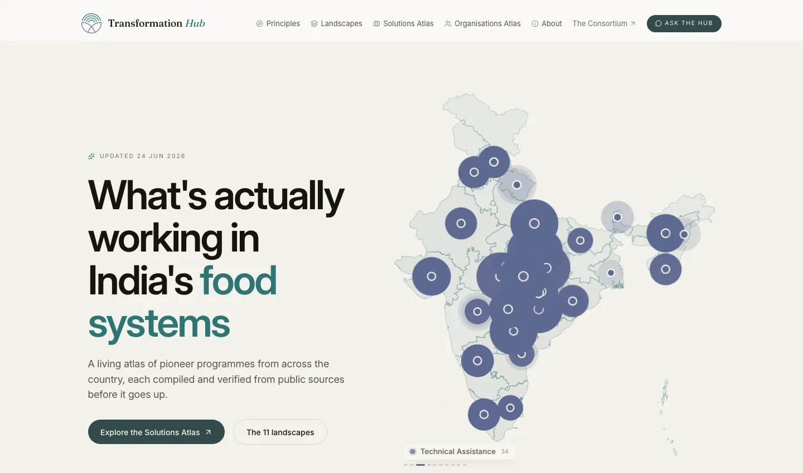
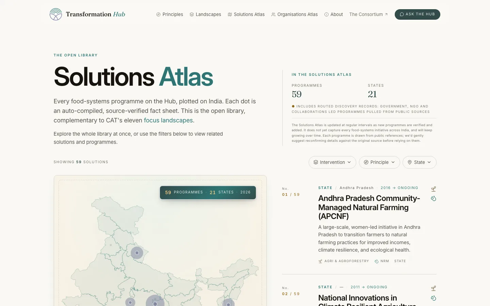
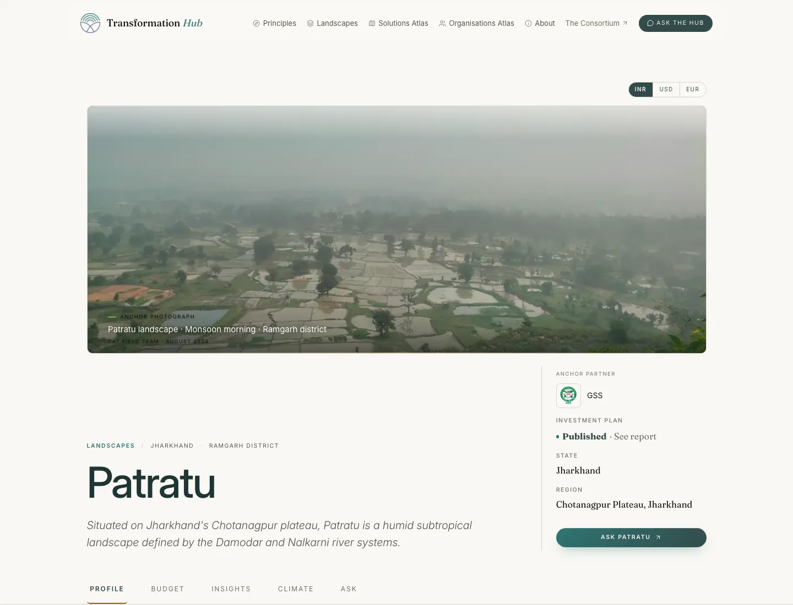
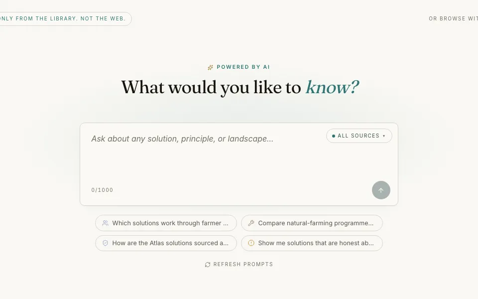
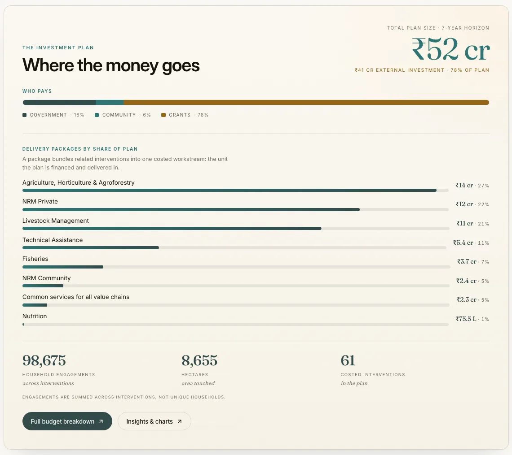

<div align="center">

# Transformation Hub

**What's actually working in India's food systems.**

A public dashboard of food systems programmes across India, from government missions to farmer federations.<br>
Every entry is drafted from public sources, checked by an editor, and cited. What didn't work sits next to what did.

[**Visit the Hub**](https://hub.agroecologyindia.org) · [Case study](https://sandeep9127-hub.github.io/transformation-hub/) · [Product brief](./PRODUCT.md)

<br>



<br><br>

| 59 | 21 | 11 | 10 |
|:---:|:---:|:---:|:---:|
| programmes in the Solutions Atlas | states covered | CAT landscapes with investment plans | themes |

<sub>As shown on the live Hub, October 2026.</sub>

</div>

<br>

## What's inside

<table>
<tr>
<td width="33%" valign="top">


**Solutions Atlas**<br>
Programmes from across India on one map. Filter by intervention, principle or state; every filter is a shareable link.
</td>
<td width="33%" valign="top">


**Landscape dashboards**<br>
CAT's eleven field landscapes, each with a seven-year investment plan: profile, budget, reach, climate figures and a downloadable brief.
</td>
<td width="33%" valign="top">


**Ask the Hub**<br>
Questions in plain language, answered only from the Hub's own entries and plans, not the open web.
</td>
</tr>
</table>

## How an entry gets published

| 1. Discover | 2. Draft | 3. Review | 4. Publish | 5. Keep fresh |
|---|---|---|---|---|
| A weekly search of trusted domains turns up candidate programmes. | An AI model drafts the entry from its sources, with citations. | An editor checks it against the sources, then approves or returns it. | It goes on the map, into search and into its themes. | A daily check flags entries whose sources have changed. |

AI does the production work. Nothing goes live until a person approves it.

<details>
<summary><b>Example: where the money goes in one landscape plan</b></summary>
<br>

</details>

<br>

## Run by

The [Consortium for Agroecological Transformations](https://agroecologyindia.org) (CAT). Product brief, design and build by [Sandeep Nayak](https://github.com/sandeep9127-hub).

<br>

---

# Developer notes

The CAT Platform is the codebase behind the Hub, built per [PRODUCT.md](./PRODUCT.md).

Live on a Supabase Postgres in an isolated `cat` schema. Run on Vercel.

## What ships

**Public surface (read)**
- `/` — landing with hero, atlas (India map + entry list with state filter), stat strip, theme grid, featured entry
- `/entry/[slug]` — entry detail with four narrative blocks at equal weight + red-tinted "what did not work" callout
- `/theme/[slug]` — editorial intro + reading list
- `/organisation/[slug]` — `roles_held` aggregation computed at query time
- `/landscapes` — index of the 11 CAT focus landscapes (Ahwa, Chitrakonda, Dantewada, Dharashiv, Khatarshnong Laitkroh, Mau, Pangi, Patharpratima, Patratu, Rajnagar, Vempalli)
- `/landscape/[slug]` — landscape detail with LIP status, context, three-levers callout, related programmes
- `/map` — full-bleed atlas deep view
- `/resources` — filterable library
- `/news` — dated feed grouped by month
- `/search` — Postgres full-text search across entries with theme/scale/endorsement filters
- `/agent` — public agent preview, 5-turn cap, tool-use against the schema (requires `ANTHROPIC_API_KEY`)
- `/about` — CAT's mission + the Three Levers (Policy · Markets · Finance)
- `/editorial-process` — how an entry gets published, six numbered steps
- `/contribute` — submission form with autosave, four narrative blocks, source URLs
- 404 page, error boundary, sitemap.xml, robots.txt, skip-to-content link

**Admin desk** (`/admin/*`, env-gated until Auth.js lands)
- `/admin` — four-queue overview: AI drafts · discovery candidates · freshness flags · contributor submissions + recent runs
- `/admin/review/[id]` — side-by-side review with source passages, editable draft fields, keyboard shortcuts (`a` approve, `r` return, `s` save)
- `/admin/sources` — source registry CRUD with tier and frequency
- `/admin/runs` — ingestion run history with cost capture and manual trigger buttons

**Ingestion pipeline**
- `/api/cron/registry-crawl` — weekly Mon 03:00; fetches every active source, updates content hash
- `/api/cron/discovery` — weekly Wed 03:00; Claude Sonnet 4.6 + Anthropic web search, allowlisted domains, yields 3-8 candidate programmes per run
- `/api/cron/draft-writer` — manual trigger; fetches a candidate's source URLs, drafts an Entry with citation anchors (Claude Sonnet 4.6)
- `/api/cron/freshness-sweep` — daily 06:00; re-fetches canonical sources, flags entries with changed content
- All four wrapped in `startRun()` telemetry: `ingestion_runs` row per execution with processed/yielded/cost/errors
- Vercel cron secrets via `CRON_SECRET` bearer token in production; open in development

**Data layer**
- Full Drizzle schema in `lib/db/schema.ts` covering every entity from PRODUCT.md §9 including Auth.js core tables, source registry, ingestion runs, discovery candidates, draft entries, freshness flags, entry revisions, agent telemetry, vector store (pgvector column managed via raw migration)
- Postgres FTS via generated `tsvector` column with weighted fields and GIN index
- Cached `postgres-js` client across HMR (`globalThis`) with `max: 4` to avoid Supabase connection-slot exhaustion

## Stack

Next.js 15 App Router · React 19 · TypeScript strict · Tailwind v3 · Drizzle ORM · Postgres (Supabase, ap-south-1 Mumbai) · **Kimi K2 (Moonshot) via NVIDIA's hosted API** as primary LLM for the agent and draft writer (free tier, OpenAI-compatible) · Anthropic Claude only for the discovery agent (needs the web_search tool) · d3-geo · Resend (optional, for submission emails) · Vercel cron · GIN-indexed Postgres FTS.

Not used: Redux/Zustand (RSC + URL state), Algolia/Elasticsearch (Postgres FTS), Leaflet/Mapbox (custom SVG), Mixpanel/Amplitude (lean observability).

## Setup

```bash
npm install --legacy-peer-deps   # peer conflict with @react-pdf

cp .env.example .env.local
# Required:  DATABASE_URL
# Optional:  NVIDIA_API_KEY     (Kimi K2 — agent preview + draft writer; free tier)
#            ANTHROPIC_API_KEY  (discovery agent only — needs web_search tool)
#            RESEND_API_KEY     (submission acknowledgement email)
#            CRON_SECRET        (Vercel cron auth in production)
#            AUTH_SECRET        (Auth.js sessions, deferred)

npm run db:migrate           # apply generated migrations
npm run db:seed              # 8 themes, 30 states, 11 landscapes, 10 orgs, 5 entries, 8 resources, 6 news items
npm run geo:download         # writes public/geo/india-states.json (Datameet admin-1)

npm run dev                  # http://localhost:3000
```

## What's deferred (post-v1)

- Auth.js magic-link gating for `/admin` and contributor accounts (current dev has env-flag bypass; contribute form uses email as lightweight identity)
- pgvector embedding ingestion + semantic-synthesis paragraph on `/search`
- Map landscape and river-basin overlays (real GeoJSON polygons for the 11 landscapes)
- Funder PDF brief builder via `@react-pdf/renderer`
- Conversation export on the agent
- Discovery agent's web-search backend choice — currently the Anthropic web search tool; the registry-first model means open-web spread is bounded

## Design system

Tokens in `app/globals.css`, mirrored to Tailwind via `tailwind.config.ts`.

- **Palette** (official CAT): teals `#334B4A` deep, `#2E7573` mid, `#95B1AF` soft, plus periwinkles `#5E6990`/`#929CC5` and accents `#C68F95` rose, `#F8A07B` peach, `#F8CA7C` amber. Paper `#FBF8F2` / cream `#F8F4ED` surfaces.
- **Type**: Fraunces serif (variable) for headings + italic editorial signature · Inter sans for body and UI · JetBrains Mono uppercase tracked for meta and badges. One scale, ratio ≥ 1.25.
- **No em dashes anywhere.** Locked.
- **No "agroecology" on the public surface beyond the CAT brand subtitle.** Locked.

## Standing rules

1. Curated, not crowdsourced.
2. Programme-level, never activity-level.
3. "What did not work" is required design infrastructure.
4. AI scales production, never editorial judgement.
5. Funders never register.
6. The map is not GIS.
7. Honest provenance, public.
8. One visual language across public + admin.
9. Plain language, no marketing words.
10. Schema discipline.

## Repository

[github.com/sandeep9127-hub/cat-platform](https://github.com/sandeep9127-hub/cat-platform)
